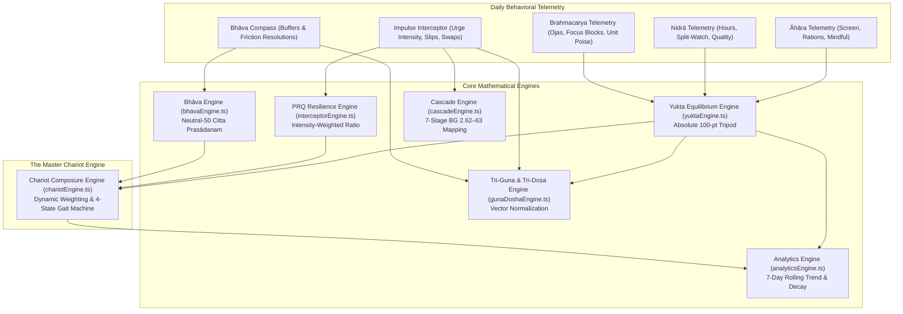

# BrahmaPath: Core Mathematical Models & Algorithmic Engines Specification

## Executive Overview & Axiomatic Design Principles

BrahmaPath translates centuries-tested classical mind-body psychology—from the *Bhagavad Gītā*, *Kaṭha Upaniṣad*, *Caraka Saṃhitā*, and Patañjali’s *Yoga Sūtras*—into **deterministic, continuous, non-punitive mathematical algorithms**. 

Unlike modern habit-tracking applications that employ arbitrary binary streaks and rigid lockouts, BrahmaPath’s computational framework operates on three foundational axioms:

1. **Deterministic Equivalence & Proportionality**: Every daily score is calculated across continuous piecewise curves bounded strictly in $[0, 100]$, ensuring real-time UI predictability and smooth feedback.
2. **Non-Judgmental Compassion (*Karuṇā*)**: The mathematics never enforce binary zero-resets upon a missed day or an honest slip. Slips are weighted as valuable data points; 1-tap post-slip resolutions restore resilience scores instantly.
3. **Dual-Arena Behavioral Context**: Mathematical weights dynamically adapt between **Stage 1 (Civilian Inner Battleground)** and **Stage 2 (Sentinel Frontline Battleground)**, accommodating civilian study/work rhythms as well as extreme operational environments (high-altitude cold, split-sentry watches, and cantonment stations).

---

## Architecture of Mathematical Engines

The platform is driven by eight interoperable, deterministic computational engines:



---

## 1. The Master Chariot Composure Engine (`chariotEngine.ts`)

### 1.1 State Space Definition
The live state of the *Ratha* (Chariot) represents total psychometric composure and maps directly to the classical allegory of *Kaṭha Upaniṣad 1.3.3–4*:

$$\mathcal{S} = \{\text{Resting}, \, \text{Calm}, \, \text{Brisk}, \, \text{Galloping}\}$$

Where:
- **Resting (Tranquil Stillness)**: Early morning unlogged state or deep Tamasic inertia requiring gentle awakening.
- **Calm (Sattvic Poise)**: Harmonious alignment of senses, intellect, and emotional stability.
- **Brisk (Rajasic Momentum)**: High constructive energy requiring conscious steering to prevent distraction.
- **Galloping (Unchecked Agitation)**: Senses pulling at the reins; active impulse intervention required.

---

### 1.2 Dynamic Composure Weighting Equation
A critical innovation in BrahmaPath is the **Standby vs. Active Interceptor Weighting Formulation**. 

In conventional habit trackers, unlogged features penalize the user with a score of zero. BrahmaPath dynamically reallocates weights so that an urge-free day is rewarded rather than penalized:

$$\text{ComposureScore} = \begin{cases} 
0 & \text{if } \text{hasAppActivityToday} = \text{false} \\ 
\text{round}\left(0.65 \times Yukta + 0.35 \times Bh\bar{a}va\right) & \text{if } \text{interceptorActive} = \text{false} \\ 
\text{round}\left(0.50 \times Yukta + 0.25 \times PRQ + 0.25 \times Bh\bar{a}va\right) & \text{if } \text{interceptorActive} = \text{true} 
\end{cases}$$

Bounded strictly:
$$\text{ComposureScore} \in [0, 100]$$

#### Mathematical Rationale:
- **Standby Mode ($N_{\text{interceptions}} = 0$)**: When no urges or distractions occurred today, the Impulse Interceptor remains on standby. Composure is derived exclusively from the biological foundation ($Yukta$, 65%) and emotional attunement ($Bh\bar{a}va$, 35%).
- **Active Mode ($N_{\text{interceptions}} > 0$)**: When an urge or slip is logged, the Interceptor activates. Composure seamlessly splits: 50% biological grounding ($Yukta$), 25% impulse restraint resilience ($PRQ$), and 25% emotional conditioning ($Bh\bar{a}va$).

---

### 1.3 State Transition Logic & Gate Invariants
The gait state transition is governed by strict deterministic threshold invariants:

```typescript
const isResting = !hasAppActivityToday || (dominantGuna === 'Tamas' && composureScore < 42);

const isCalm = composureScore >= 75 &&
               loggedPillarCount >= 2 &&
               unresolvedNegativeBhavaCount === 0;

const isGalloping = composureScore < 50 ||
                   (loggedPillarCount === 1 && composureScore < 58);

const state: ChariotState = isResting ? 'Resting'
                          : isCalm ? 'Calm'
                          : isGalloping ? 'Galloping'
                          : 'Brisk';
```

#### Key Invariants:
1. **Calm Tri-Condition Requirement**: Attaining the *Calm* state requires not only high composure ($\text{Composure} \ge 75$), but also biological consistency ($N_{\text{logged\_pillars}} \ge 2$) and emotional resolution ($N_{\text{unresolved\_bhava}} = 0$). One cannot be "Calm" while harboring active emotional turbulence.
2. **Single-Pillar Vulnerability Guard**: If only 1 pillar is logged and composure is below 58, the state demotes to *Galloping*, reflecting incomplete biological anchorage.

---

### 1.4 Chariot Component Telemetry Formulations
- **Horses (Indriyas / Senses Score)**:
  $$\text{SensoryAvg} = \text{round}\left(\frac{Yukta + Bh\bar{a}va}{2}\right)$$
  - $\text{SensoryAvg} \ge 75 \implies \text{"Tranquil & Harmonious"}$
  - $\text{SensoryAvg} \in [50, 74] \implies \text{"Dynamic & Active"}$
  - $\text{SensoryAvg} < 50 \implies \text{"Restless & Straining"}$
  - $\text{At Rest} \implies \text{"Stabled in Pasture"}$

- **Reins (Manas / Mental Poise Score)**:
  $$\text{ReinsScore} = \begin{cases} PRQ & \text{if active} \\ Yukta & \text{if standby} \end{cases}$$
  - $\text{ReinsScore} \ge 75 \implies \text{"Pliant & Sensitive"}$
  - $\text{ReinsScore} \in [50, 74] \implies \text{"Firm & Steady"}$
  - $\text{ReinsScore} < 50 \implies \text{"Slack & Drifting"}$
  - $\text{At Rest} \implies \text{"Draped without Tension"}$

---

## 2. The 3-Pillar Sadhana Equilibrium Engine (`yuktaEngine.ts`)

### 2.1 The Absolute 100-Point Tripod (*Trayopastambha*)
Grounded in *Caraka Saṃhitā Sūtrasthāna 11.35*, health and mental poise rest upon three biological pillars: Food/Intake (*Āhāra*), Sleep (*Nidrā*), and Vitality/Conservation (*Brahmacarya*). 

BrahmaPath models this as an absolute 100-point additive tripod:

$$Yukta = S_{\text{Āhāra}} + S_{\text{Nidrā}} + S_{\text{Brahmacarya}} \in [0, 100]$$

$$\text{Max Points: } S_{\text{Āhāra}}^{\max} = 34, \quad S_{\text{Nidrā}}^{\max} = 33, \quad S_{\text{Brahmacarya}}^{\max} = 33$$

$$\text{Sum Check: } 34 + 33 + 33 = 100$$

**Pillar Independence Invariant**: Each pillar is computed independently. If a user only logs *Nidrā*, $S_{\text{Nidrā}} \in [0, 33]$ while $S_{\text{Āhāra}} = 0$ and $S_{\text{Brahmacarya}} = 0$.

---

### 2.2 Pillar 1: Āhāra Formulation (Max 34 Points)
$$S_{\text{Āhāra}} = \min\left(34, \, P_{\text{nutrition}} + P_{\text{screen}} + P_{\text{mindful}}\right)$$

#### 1. Nutrition & Metabolic Quality ($P_{\text{nutrition}} \in [0, 10]$):
- **Stage 1 (Civilian)**:
  $$P_{\text{nutrition}} = \begin{cases} 10 & \text{Sattvic (fresh, whole, calm digestion)} \\ 6 & \text{Rajasic (spicy, rushed, stimulant-heavy)} \\ 2 & \text{Tamasic (stale, processed, excessive)} \end{cases}$$
- **Stage 2 (Sentinel)**:
  $$P_{\text{nutrition}} = \begin{cases} 10 & \text{Balanced Ration (timed hydration, steady energy)} \\ 6 & \text{High-Watch Caffeine (heavy watch-tea/energy stimulants)} \\ 2 & \text{Irregular / Missed Ration (extended patrol deficit)} \end{cases}$$

#### 2. Self-Anchored Continuous Relative Screen Time ($P_{\text{screen}} \in [0, 12]$):
Rather than judging screen time against an arbitrary universal standard (e.g. 2 hours), BrahmaPath computes the ratio against the user’s self-anchored rolling average:

$$r = \frac{T_{\text{actual}}}{T_{\text{baseline}}}$$

Where $T_{\text{baseline}} = \max(60, \text{baselineMinutes})$. The continuous piecewise scoring function is defined as:

$$P_{\text{screen}}(r) = \begin{cases} 
\text{round}\left(12 - 2.67 \times r\right) & \text{for } r \le 0.75 \\ 
\text{round}\left(10 - 12 \times (r - 0.75)\right) & \text{for } 0.75 < r \le 1.0 \\ 
\max\left(0, \, \text{round}\left(7 - 11.67 \times (r - 1.0)\right)\right) & \text{for } r > 1.0 
\end{cases}$$

##### 4-Zone Categorization:
| Zone | Ratio Range ($r$) | Description | Feedback & Tone |
| :--- | :--- | :--- | :--- |
| **Deep Recovery** | $r \le 0.50$ | Significant drop below average | Celebrates deep offline focus |
| **Steady Reduction** | $0.50 < r \le 0.85$ | Stepped back from habit | Supportive positive reinforcement |
| **Maintained Baseline** | $0.85 < r \le 1.125$ | Held within regular average | Calm encouragement to stay steady |
| **Above Baseline** | $r > 1.125$ | Exceeded regular consumption | Shame-free reset, forgiving drift |

#### 3. Sensory Mindfulness / Call Digestion ($P_{\text{mindful}} \in [0, 12]$):
Mapped from the 5-point slider input $m \in [1, 5]$:
$$P_{\text{mindful}} = \text{clamp}\left(0, 12, \, \text{round}\left((m - 1) \times 3\right)\right) \implies \{0, 3, 6, 9, 12\}$$

---

### 2.3 Pillar 2: Nidrā Formulation (Max 33 Points)
$$S_{\text{Nidrā}} = \min\left(33, \, P_{\text{duration}} + P_{\text{consistency}} + P_{\text{quality}}\right)$$

#### 1. Continuous Circadian Sleep Curve ($P_{\text{duration}} \in [0, 15]$):
For hours slept $h \ge 0$:

$$P_{\text{duration}}(h) = \begin{cases} 
\text{round}\left(\frac{h}{7.5} \times 15\right) & \text{for } h \le 7.5 \\ 
15 & \text{for } 7.5 < h \le 8.5 \\ 
\max\left(6, \, \text{round}\left(15 - (h - 8.5) \times 2\right)\right) & \text{for } h > 8.5 
\end{cases}$$

- **Stage 2 Split-Sentry Tactical Compensation**:
  Uniformed personnel often cannot sleep 8 unbroken hours due to rotating 4-hour sentry watches. If `watchRestProtocol === 'split_sentry_kurma'` and $4.5 \le h < 7.5$, the engine awards a **tactical bonus**:
  $$P_{\text{duration}} = \min(15, \, P_{\text{duration}} + 3)$$
  This guarantees that fragmented operational sleep coupled with conscious *Kūrma* power-down is never unfairly penalized.

#### 2. Consistency & Protocol Score ($P_{\text{consistency}} \in [0, 8]$):
- **Stage 1**: Consistent bedtime $= 8$, Irregular $= 2$.
- **Stage 2**: `continuous_bunk` $= 8$, `split_sentry_kurma` $= 8$, `post_watch_hypervigilance` $= 2$.

#### 3. Sleep Quality ($P_{\text{quality}} \in [0, 10]$):
- Restorative $= 10$, Fragmented / Disturbed $= 5$, Depleted / Lethargic $= 1$.

---

### 2.4 Pillar 3: Brahmacarya / Vīrya Formulation (Max 33 Points)
$$S_{\text{Brahmacarya}} = \min\left(33, \, P_{\text{energy}} + P_{\text{focus}} + P_{\text{guna\_cohesion}}\right)$$

#### 1. Ojas / Energy Conservation ($P_{\text{energy}} \in [0, 12]$):
Mapped from slider input $e \in [1, 5]$:
$$P_{\text{energy}} = \text{clamp}\left(0, 12, \, \text{round}\left((e - 1) \times 3\right)\right) \implies \{0, 3, 6, 9, 12\}$$

#### 2. Focused Blocks / Grounding Wins ($P_{\text{focus}} \in [0, 13]$):
For blocks completed $B$:
- **Stage 1 (0–10 block civilian scale)**:
  $$P_{\text{focus}} = \min\left(13, \, \text{round}\left(B \times 2.2\right)\right)$$
- **Stage 2 (0–6 block sentinel scale)**:
  $$P_{\text{focus}} = \min\left(13, \, \text{round}\left(B \times 3.25\right)\right)$$

#### 3. Guna Alignment / Unit Cohesion ($P_{\text{guna\_cohesion}} \in [0, 8]$):
- **Stage 1**: Sattva $= 8$, Rajas $= 4$, Tamas $= 1$.
- **Stage 2**: `sahyog_connected` $= 8$, `command_friction` $= 4$, `isolated_fatigue` $= 1$.

---

## 3. The Impulse Interceptor & PRQ Engine (`interceptorEngine.ts`)

The Pratipaksha Resilience Quotient ($PRQ$) models the cognitive capacity to interrupt impulsive dopaminergic loops (*Vāṅ-maya Tapas* and *Pratipakṣa Bhāvana*).

### 3.1 Cognitive Load Weighting
Let today's logged events be partitioned into successful interceptions $\mathcal{E}_{\text{succ}}$ and mindful slips $\mathcal{E}_{\text{slip}}$. Each event has an urge intensity $I \in [1, 5]$:

$$W_{\text{pos}} = \sum_{i \in \mathcal{E}_{\text{succ}}} \left(0.70 + 0.30 \times I_i\right)$$

$$W_{\text{neg}} = \sum_{j \in \mathcal{E}_{\text{slip}}} \left(0.80 + 0.35 \times I_j\right)$$

Notice that $W_{\text{neg}}$ carries slightly higher baseline load ($0.80$ vs $0.70$), reflecting the real cognitive friction of an unmitigated urge.

---

### 3.2 Attentional Challenge Scaling Factor
Successfully intercepting a high-intensity urge (Intensity 4 or 5) demonstrates far greater executive control than batting away a trivial notification (Intensity 1). The challenge scaling factor $\Phi$ rewards total intercepted intensity:

$$\Phi(I_{\text{total}}) = \min\left(1.0, \, 0.78 + 0.045 \times \sum_{i \in \mathcal{E}_{\text{succ}}} I_i\right)$$

---

### 3.3 The Final PRQ Equation
$$R_{\text{raw}} = \frac{W_{\text{pos}}}{W_{\text{pos}} + W_{\text{neg}}}$$

$$PRQ = \begin{cases} 
0 & \text{if } |\mathcal{E}_{\text{succ}}| = 0 \text{ and } |\mathcal{E}_{\text{slip}}| > 0 \\ 
\text{clamp}\left(0, 100, \, \text{round}\left(100 \times R_{\text{raw}} \times \Phi(I_{\text{total}})\right)\right) & \text{otherwise} 
\end{cases}$$

#### The Active Negative Score Principle:
If a user logs only slips today ($|\mathcal{E}_{\text{succ}}| = 0$ and $|\mathcal{E}_{\text{slip}}| > 0$), $PRQ = 0$. Because $PRQ$ enters the Chariot Composure equation at 25% weight, this actively and transparently pulls down the Chariot Composure score. The user sees their struggle reflected immediately.

#### 1-Tap Shame-Free Recovery:
When the user taps **"Resolve"** on a slip, the item is dynamically reclassified from $\mathcal{E}_{\text{slip}}$ to $\mathcal{E}_{\text{succ}}$. The formula instantly recomputes, restoring the user's PRQ score without residual penalties, validating Patanjali's compassionate principle of continuous restoration.

---

## 4. The 7-Stage Compulsion Cascade Engine (`cascadeEngine.ts`)

Grounded in *Bhagavad Gītā 2.62–63*, the engine models the transition from subtle sensory contemplation into total executive paralysis:

$$\text{Stage } 1 \to \text{Stage } 2 \to \text{Stage } 3 \to \text{Stage } 4 \to \text{Stage } 5 \to \text{Stage } 6 \to \text{Stage } 7$$

$$\text{Dhyāyato} \xrightarrow{} \text{Saṅga} \xrightarrow{} \text{Kāma} \xrightarrow{} \text{Krodha} \xrightarrow{} \text{Saṃmoha} \xrightarrow{} \text{Smṛti-vibhrama} \xrightarrow{} \text{Buddhi-nāśa}$$

### 4.1 Intensity-to-Stage Mapping Algorithm
The engine evaluates the user's logged Urge Intensity $I \in [1, 5]$ and behavioral trigger to determine the active neuro-cognitive stage:

```typescript
export function estimateCascadeStage(trigger: TriggerCategory, urgeIntensity: number): CascadeStepInfo {
  const intensity = Math.max(1, Math.min(5, Math.round(urgeIntensity)));
  let stepNumber = 3;

  if (intensity === 1) {
    stepNumber = 1; // Dhyāyato (Dwelling on sense-object)
  } else if (intensity === 2) {
    stepNumber = 2; // Saṅga (Psychological attachment)
  } else if (intensity === 3) {
    if (trigger === 'Academic Anxiety' || trigger === 'Social Comparison') {
      stepNumber = 4; // Krodha (Inner agitation / cognitive friction)
    } else {
      stepNumber = 3; // Kāma (Compulsive craving surge)
    }
  } else if (intensity === 4) {
    if (trigger === 'Lethargy' || trigger === 'Doomscrolling') {
      stepNumber = 5; // Saṃmoha (Delusion / attentional trance)
    } else {
      stepNumber = 4; // Krodha (High frustration)
    }
  } else if (intensity >= 5) {
    if (trigger === 'Doomscrolling' || trigger === 'Lethargy') {
      stepNumber = 6; // Smṛti-vibhrama (Lapse of memory & vow)
    } else {
      stepNumber = 5; // Saṃmoha (Deep delusion)
    }
  }

  return GITA_CASCADE_STEPS[stepNumber - 1];
}
```

### 4.2 The Critical Bifurcation Boundary
- **Stages 1–4 ($I \le 3$)**: Tagged with `canInterceptEasily: true`. Prefrontal executive control is intact; 1-tap Pratipaksha reframes and somatic micro-swaps break the loop immediately.
- **Stages 5–7 ($I \ge 4$)**: Tagged with `canInterceptEasily: false`. The brain is in an attentional trance (hypo-frontality). The app deploys somatic grounding (cold water on face, extended Rechaka exhalation) rather than demanding complex philosophical reflection.

---

## 5. The Bhāva Compass Emotional Engine (`bhavaEngine.ts`)

Based on Patañjali’s *Citta Prasādanam* (*Yoga Sūtras 1.33*), emotional equilibrium is cultivated through four specific attitudes:

$$\text{Maitrī (Friendliness)}, \quad \text{Karuṇā (Compassion)}, \quad \text{Muditā (Empathetic Joy)}, \quad \text{Upekṣā (Equanimity)}$$

### 5.1 The Neutral-50 Formulation
Rather than starting from an artificial 0 or 100, the Bhāva Compass begins at a **true neutral psychological baseline of 50**:

$$Bh\bar{a}va = \begin{cases} 
50 & \text{if } N_{\text{logs}} = 0 \\ 
\text{clamp}\left(0, 100, \, 50 + 10 \times \min(3, N_{\text{pos}}) - 12 \times N_{\text{unres}} + 4 \times N_{\text{res}}\right) & \text{if } N_{\text{logs}} > 0 
\end{cases}$$

### 5.2 The Resolution Asymmetry Proof
Consider a user experiencing acute social comparison or peer envy:
1. Upon logging the raw friction:
   $$\Delta_{\text{friction}} = -12 \text{ points}$$
2. Upon applying the recommended *Muditā* or *Upekṣā* reframe and resolving it:
   $$\Delta_{\text{resolution}} = +4 \text{ points}$$
3. **Net Point Swing upon Resolution**:
   $$\text{Swing} = (+4) - (-12) = \mathbf{+16 \text{ points}}$$

This creates a positive mathematical reward for active emotional processing: **actively resolving an emotional affliction leaves the mind stronger than if the friction had never occurred**.

---

## 6. Tri-Guna & Tri-Doṣa Vector Engines (`gunaDoshaEngine.ts`)

### 6.1 Tri-Guna Simplex Vector Model
The psychometric state of consciousness is represented as a 3D unit simplex vector:

$$\vec{G} = [S, \, R, \, T] \in \mathbb{R}^3 \quad \text{such that} \quad S + R + T = 100, \quad S, R, T \ge 0$$

Where:
- $S = \text{Sattva}$ (clarity, harmony, luminous stillness)
- $R = \text{Rajas}$ (dynamism, restless ambition, craving)
- $T = \text{Tamas}$ (inertia, delusion, heavy fatigue)

#### Multi-Source Weight Accumulator:
$$\vec{W} = \vec{W}_{\text{sadhana}} + \vec{W}_{\text{screen}} + \vec{W}_{\text{mindfulness}} + \vec{W}_{\text{interceptor}} + \vec{W}_{\text{bhava}}$$

Normalized projection:
$$S = \text{round}\left(\frac{W_S}{W_S + W_R + W_T} \times 100\right), \quad R = \text{round}\left(\frac{W_R}{W_S + W_R + W_T} \times 100\right)$$

$$T = 100 - (S + R)$$

---

### 6.2 Tri-Doṣa Circadian Clock (*Dinacaryā*)
Grounded in *Aṣṭāṅga Hṛdayam Sūtrasthāna 1.6*, physiological humors cycle continuously:

| Time Window | Predominant Doṣa | Biological Tendency | Engine Adaptation |
| :--- | :--- | :--- | :--- |
| **06:00 – 10:00** | **Kapha** | Heavy, stable, slow | Recommends dynamic movement & warm hydration |
| **10:00 – 14:00** | **Pitta** | Sharp, metabolic Agni peak | Primary focus block window; substantial meal |
| **14:00 – 18:00** | **Vāta** | Light, mobile, creative | Guard against afternoon screen drift & anxiety |
| **18:00 – 22:00** | **Kapha** | Grounding, cooling | Blue-light taper & evening contemplation |
| **22:00 – 02:00** | **Pitta** | Internal organ cellular repair | Sleep window mandatory; avoid late-night caffeine |
| **02:00 – 06:00** | **Vāta (Brahma-muhūrta)** | Subtle, highly receptive | Prime window for meditation, Sankalpa, and study |

---

## 7. Longitudinal Analytics & Decay Engine (`analyticsEngine.ts`)

### 7.1 Natural Cognitive Drift ($Pram\bar{a}da$ Entropy)
Classical psychology recognizes that without conscious daily reflection (*Swādhyāya*), mental clarity naturally experiences Tamasic decay. 

For any unlogged historical day $t$, the equilibrium score decays by 5%:

$$Yukta_t = \max\left(0, \, \text{round}\left(Yukta_{t-1} \times 0.95\right)\right)$$

#### Properties of the Decay Function:
- **Gentle Asymptote**: Unlike binary streak resets (which drop to 0 overnight), a user with a strong 80-point foundation decays gently:
  $$80 \to 76 \to 72 \to 68 \to 65$$
  This preserves the user's hard-earned psychological capital and encourages immediate re-engagement without despair.

---

### 7.2 Rolling 7-Day Trend Point Structure
Each day in the 7-day trajectory is computed with timezone-safe local date resolution (`YYYY-MM-DD`):

```typescript
export interface RollingTrendPoint {
  date: string;              // YYYY-MM-DD local format
  displayDate: string;       // e.g. 'Nov 10'
  yuktaScore: number;        // 0–100 score (active or decayed)
  sleepHours: number;        // Circadian sleep hours
  digitalMinutes: number;    // Absolute screen minutes
  focusBlocks: number;       // Completed deep work blocks
  dominantGuna: string;      // 'Sattva' | 'Rajas' | 'Tamas'
  hasLogs: boolean;          // True if actively logged
  penaltyApplied: boolean;   // True if -5% decay was evaluated
  isToday?: boolean;         // Identifies live fluctuating day
  baselineMinutes: number;   // Snapshotted rolling baseline
}
```

---

## 8. Cognitive Reframe Validation Engine (`pratipakshaEngine.ts`)

Validates whether user-submitted Vitarka and Pratipaksha pairs represent genuine cognitive reappraisal (*Patañjali Yoga Sūtra 2.33*):

$$\text{Validate}(V, P) = \begin{cases} 
\text{Invalid (Tamas)} & \text{if } \text{length}(V) < 5 \\ 
\text{Invalid (Rajas)} & \text{if } \text{length}(P) < 8 \\ 
\text{Invalid (Rajas)} & \text{if } \text{lower}(V) = \text{lower}(P) \\ 
\text{Valid (Sattva)} & \text{otherwise} 
\end{cases}$$

#### Neurological Rationale:
- Requiring $|P| \ge 8$ ensures the user cannot dismiss the urge with a trivial single-word response (e.g. "stop" or "no"). 
- Formulating a complete, conscious opposing thought activates the dorsolateral prefrontal cortex (dlPFC), interrupting the autonomic striatal dopamine loop.

---

## 9. Comprehensive Mathematical Summary Table

| Engine | Primary Function | Input Domain | Output Range | Governing Scriptural Formula |
| :--- | :--- | :--- | :--- | :--- |
| **Chariot Composure** | Dynamic Composure & Gait State | $Yukta, PRQ, Bh\bar{a}va$ | $[0, 100], \, \mathcal{S}$ | Standby: $0.65Y + 0.35B$; Active: $0.50Y + 0.25P + 0.25B$ |
| **Sadhana Foundation** | Biological Equilibrium ($Yukta$) | Āhāra, Nidrā, Brahmacarya | $[0, 100]$ | Additive Tripod: $S_{\text{Āhāra}}(34) + S_{\text{Nidrā}}(33) + S_{\text{Brahmacarya}}(33)$ |
| **Relative Screen Time** | Continuous Self-Anchored Curve | $T_{\text{actual}}, T_{\text{baseline}}$ | $[0, 12]$ pts | Piecewise: $12 - 2.67r$ ($r \le 0.75$), $10 - 12(r-0.75)$ ($r \le 1.0$), $7 - 11.67(r-1)$ |
| **Sleep Architecture** | Restorative Circadian Window | Hours, Protocol, Quality | $[0, 33]$ pts | $h \le 7.5 \implies \frac{h}{7.5} \times 15$; Split-Sentry $+3$ bonus |
| **Impulse Interceptor** | Pratipaksha Resilience Quotient | $I_i \in [1, 5], \text{Slips}$ | $[0, 100]$ | $100 \times \frac{W_{\text{pos}}}{W_{\text{pos}} + W_{\text{neg}}} \times \min(1.0, 0.78 + 0.045 I_{\text{total}})$ |
| **Cascade Visualizer** | 7-Stage Compulsion Mapping | Trigger, Urge Intensity | Stage $1..7$ | Gita 2.62–63 mapping with anxiety/doomscroll shifts |
| **Bhāva Compass** | Heart Conditioning Balance | Buffers, Frictions | $[0, 100]$ | $50 + 10 \times \min(3, N_{\text{pos}}) - 12 N_{\text{unres}} + 4 N_{\text{res}}$ |
| **Tri-Guna Vector** | Consciousness Simplex Vector | Telemetry logs | $\Delta^2$ ($S+R+T=100$) | Multi-source normalized projection |
| **Cognitive Drift** | Natural Entropy Decay | $Yukta_{t-1}$ | $[0, 100]$ | $Yukta_t = \max(0, \text{round}(Yukta_{t-1} \times 0.95))$ |
| **Reframe Validator** | Semantic Antidote Quality | Text strings $V, P$ | Boolean & Guna | Length bounds $|V| \ge 5, |P| \ge 8$ and semantic non-duplication |

---

## 10. Verification & Deterministic Test Cases

To verify mathematical consistency across releases, the following deterministic reference cases should evaluate identically:

### Test Case 1: Early Morning Pristine Resting State
- **Inputs**: $N_{\text{logged\_pillars}} = 0, \, N_{\text{interceptions}} = 0, \, N_{\text{bhava}} = 0$.
- **Expected Outputs**:
  - $Yukta = 0$
  - $PRQ = 0$
  - $Bh\bar{a}va = 50$ (Standby default)
  - $\text{Composure} = 0$
  - $\text{State} = \text{"Resting"}$

### Test Case 2: Pure Urge-Free Focused Day (Standby Interceptor)
- **Inputs**: $Yukta = 85, \, N_{\text{interceptions}} = 0, \, Bh\bar{a}va = 70$.
- **Calculation**: $\text{Composure} = \text{round}(0.65 \times 85 + 0.35 \times 70) = \text{round}(55.25 + 24.5) = \mathbf{80}$.
- **Expected State**: $\text{"Calm"}$ ($80 \ge 75$, pillars $\ge 2$, unresolved $= 0$).

### Test Case 3: High Urge Interception Day (Active Interceptor)
- **Inputs**: $Yukta = 80, \, \mathcal{E}_{\text{succ}} = [I=4, I=5], \, \mathcal{E}_{\text{slip}} = [I=2], \, Bh\bar{a}va = 60$.
- **PRQ Calculation**:
  - $W_{\text{pos}} = (0.7 + 0.3 \times 4) + (0.7 + 0.3 \times 5) = 1.9 + 2.2 = 4.1$
  - $W_{\text{neg}} = 0.8 + 0.35 \times 2 = 1.5$
  - $R_{\text{raw}} = \frac{4.1}{4.1 + 1.5} = \frac{4.1}{5.6} \approx 0.7321$
  - $I_{\text{total}} = 4 + 5 = 9 \implies \Phi = \min(1.0, 0.78 + 0.045 \times 9) = \min(1.0, 1.185) = 1.0$
  - $PRQ = \text{round}(100 \times 0.7321 \times 1.0) = \mathbf{73}$
- **Composure Calculation**:
  - $\text{Composure} = \text{round}(0.50 \times 80 + 0.25 \times 73 + 0.25 \times 60) = \text{round}(40 + 18.25 + 15) = \mathbf{73}$.
- **Expected State**: $\text{"Brisk"}$ (active momentum, $73 < 75$).
